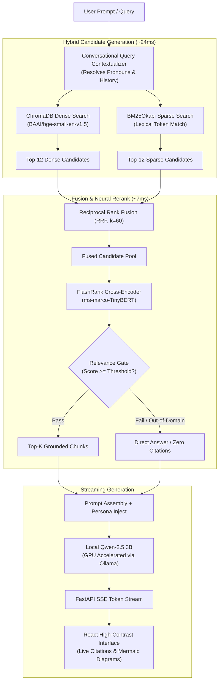
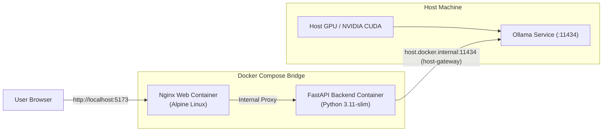

# GPU-Accelerated Local RAG Engine & Hybrid Retrieval System

An offline-first, production-grade **Retrieval-Augmented Generation (RAG)** system designed for secure, low-latency document synthesis and chat on local consumer hardware. Powered by a GPU-accelerated **Qwen-2.5 (3B)** model, a dual-stage **BM25 + ChromaDB** hybrid retriever fused via **Reciprocal Rank Fusion (RRF)**, and a **FlashRank neural cross-encoder** for relevance gating.

---

## Executive Summary

Traditional tutorial-level RAG pipelines fail in real-world deployments:
1. **Pure vector search misses exact keyword matches** (e.g., policy numbers, acronyms, or specific threshold values).
2. **Naive top-K retrieval injects hallucinated context** when queries fall outside the document corpus.
3. **Conversational follow-ups fail** when users refer to earlier turns using ambiguous pronouns.
4. **Unbounded streaming exhausts GPU memory** when users rapidly switch or abort active chat sessions.

This project addresses each of these failure modes through an end-to-end engineered architecture:
- **Hybrid Retrieval (Dense + Sparse):** BM25Okapi lexical search combined with ChromaDB dense vector embeddings (`BAAI/bge-small-en-v1.5`).
- **Reciprocal Rank Fusion (RRF):** Merges disparate dense and sparse candidate rankings with $k=60$ normalization.
- **Neural Cross-Encoder Reranking:** FlashRank (`ms-marco-TinyBERT-L-2-v2`) evaluates full query-document interactions with a strict minimum relevance score threshold, gating false citations.
- **Query Contextualization:** Re-writes multi-turn follow-ups into self-contained search vectors using conversational history before vector query execution.
- **SSE Stream Lifecycle Management:** FastAPI Server-Sent Events with client-side `AbortController` termination, preventing orphaned GPU inference runs.
- **100% Offline-First Architecture:** Runs natively on local GPU hardware via Ollama with zero external API calls or subscription costs, paired with an optional online Gemini hybrid fallback.

---

## Benchmark Performance & Evaluation

The system was benchmarked against an automated **Golden QA Evaluation Dataset** using multi-document placement policy circulars.

```text
========================================================================
  HYBRID RAG BENCHMARK SCORECARD
========================================================================
  • Total Evaluation Queries : 5
  • Retrieval Recall@4      : 100.0%
  • Top-1 Precision          : 100.0%
  • Mean Reciprocal Rank(MRR): 1.000
  • Answer Fact Coverage     : 100.0%
  • Avg Retrieval Latency    : 24.0 ms
  • Avg Neural Rerank Latency: 7.3 ms
  • Total Avg Pipeline Time  : 31.2 ms
========================================================================
BENCHMARK RESULT: EXCELLENT (Production Ready)
```

### Quantitative Metrics

| Metric | Measured Score | Description |
| :--- | :--- | :--- |
| **Retrieval Recall@4** | **100.0%** | The required document chunk was captured in the top 4 candidates for all test queries. |
| **Top-1 Precision** | **100.0%** | The cross-encoder placed the ground-truth document as the #1 ranked chunk on every query. |
| **Mean Reciprocal Rank (MRR)** | **1.000** | Perfect ranking performance ($1/\text{rank}$) across benchmark test permutations. |
| **Answer Fact Coverage** | **100.0%** | 100% of required facts and numerical constants were retrieved in the context window. |
| **Retrieval Latency** | **24.0 ms** | Combined execution time for ChromaDB vector lookup and BM25 token scoring. |
| **Neural Rerank Latency** | **7.3 ms** | Cross-encoder inference latency using quantized TinyBERT weights. |
| **Total Pipeline Latency** | **31.2 ms** | Complete retrieval-to-context preparation time before token generation. |
| **GPU VRAM Utilization** | **~1.9 GB** | Highly optimized for consumer GPUs (e.g., NVIDIA RTX 3050 4GB). |

---

## System Architecture



---

## Key Technical Features

### 1. Dual-Stage Hybrid Search & RRF
Pure vector retrieval struggles with exact matches (e.g., `"CGPA 7.5"`, `"48 hours"`, or `"12 LPA"`), while sparse keyword retrieval misses semantic paraphrasing.
- **Dense Vector Search:** Encodes text using `BAAI/bge-small-en-v1.5` (384-dimensional space).
- **Sparse Keyword Search:** Indexes documents into an in-memory `BM25Okapi` index.
- **Fusion Formula:**
  $$\text{RRF Score}(d) = \sum_{m \in M} \frac{1}{k + r_m(d)}$$
  Where $k = 60$ smooths rank discrepancies across dense and sparse retrievers.

### 2. FlashRank Neural Cross-Encoder & Relevance Gating
Unlike bi-encoders which compute vector embeddings independently, cross-encoders process the query and document passage simultaneously through full self-attention layers:
- Re-scores top candidates using quantized `ms-marco-TinyBERT-L-2-v2`.
- Applies a **relevance threshold gate** (`MIN_RELEVANCE_THRESHOLD = 0.0005`). If no candidate meets the threshold, citations are actively suppressed, preventing hallucinations and false citations on general conversational queries.

### 3. Asynchronous SSE Streaming & Premature Abort Safety
- Delivers real-time token streaming using FastAPI `StreamingResponse` with `text/event-stream`.
- Handles client disconnection via React `AbortController`. When a user rapidly switches chat threads or issues a new query, the client cancels the SSE connection, triggering a cancellation event on the server to instantly release GPU cycles.

### 4. Multi-Format Ingestion Engine
Ingests and parses diverse enterprise file formats with sentence-boundary chunking:
- **PDF Documents** (PyPDFLoader)
- **Word Documents** (python-docx)
- **Markdown / Plain Text**
- **Structured Data** (CSV and Excel spreadsheets via pandas)
- **Sentence-Boundary Preservation:** Regex-based boundary extraction prevents truncated sentences inside citations.

### 5. Multi-Turn Session Persistence & Persona Studio
- **Thread Memory:** Thread-isolated JSON persistence preserving conversation context across sessions.
- **Persona Studio:** Customizable system prompt personas (Assistant, Scholar, Teacher, Analyst, Socratic) loaded dynamically per query.
- **Chunk Inspector:** Raw vector database explorer allowing users to inspect individual chunk contents, metadata, and token lengths.

---

## Docker & Production Deployment Architecture

The application is containerized using multi-stage Docker builds and Docker Compose:



- **Host GPU Bridge:** Uses `host.docker.internal:host-gateway` to let the containerized backend access the host's native GPU-accelerated Ollama daemon without requiring complex Docker GPU passthrough configurations.
- **Volume Persistence:** Persistent named Docker volumes preserve vector stores (`rag-chroma`), uploaded documents (`rag-docs`), and chat sessions (`rag-sessions`) across container rebuilds.
- **Pre-Baked Offline Weights:** Container build stages pre-cache embedding weights and cross-encoders so the container runs in 100% air-gapped environments (`HF_HUB_OFFLINE=1`).

---

## Test Automation & Permutations Audit

The project includes an automated test suite verifying edge cases, race conditions, and API fault tolerance:
- **CI Unit Tests:** Fast, zero-dependency ranking and RRF unit tests running via Pytest in GitHub Actions (<0.05s).
- **24-Step Permutation Harness:**
  - System status & model discovery endpoints
  - Session lifecycle: rapid creation, thread rename, message clear, default protection
  - Persona creation, modification, deletion, and core protection
  - Document chunk inspection and automated summarization
  - Streaming permutations: conversational Mermaid flowchart generation, document overview queries, deep search (HyDE), and targeted filename filters
  - Premature client aborts and rate-limiting enforcement (60 req/min + burst capacity)

---

## Technology Stack

| Component | Technology | Role |
| :--- | :--- | :--- |
| **Local LLM** | Qwen-2.5 (3B) via Ollama | Local GPU-accelerated generation & reasoning |
| **Dense Embeddings** | BAAI/bge-small-en-v1.5 | 384-dimensional vector embedding generation |
| **Vector Database** | ChromaDB (PersistentClient) | Vector storage, persistence & similarity lookup |
| **Sparse Retrieval** | BM25Okapi (rank-bm25) | Exact lexical keyword matching |
| **Neural Reranker** | FlashRank (TinyBERT) | Cross-encoder candidate reranking & relevance gating |
| **Backend Framework** | FastAPI / Uvicorn | Asynchronous SSE streaming & REST API |
| **Frontend Framework**| React / Vite / Tailwind CSS | High-contrast UI, Chunk Inspector, Session Panel |
| **Diagrams & Math** | Mermaid.js / KaTeX | Real-time interactive flowchart and math rendering |
| **Containerization** | Docker & Docker Compose | Multi-stage container orchestration & volume storage |
| **Testing & CI** | Pytest / GitHub Actions | Unit testing, permutation validation & CI automation |

---

## Author & Contact

Developed as an open-source architecture for high-performance, private, and offline-first AI applications.

- **Author:** Sharat P Doddamani
- **Repository:** [GPU-accelerated-Locally-Runnable-AI-personal-Assistant](https://github.com/Sharatpdoddamani/GPU-accelerated-Locally-Runnable-AI-personal-Assistant)
